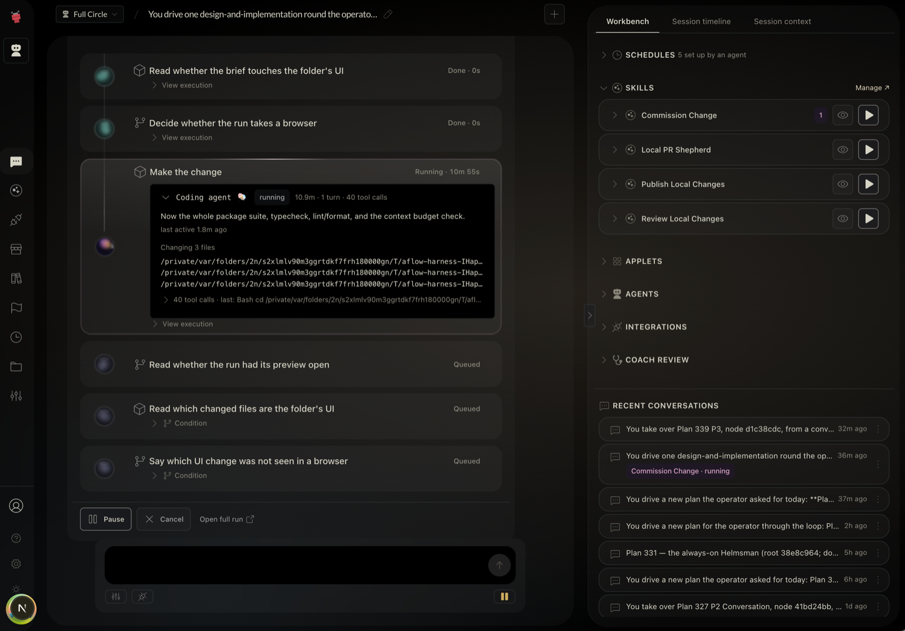
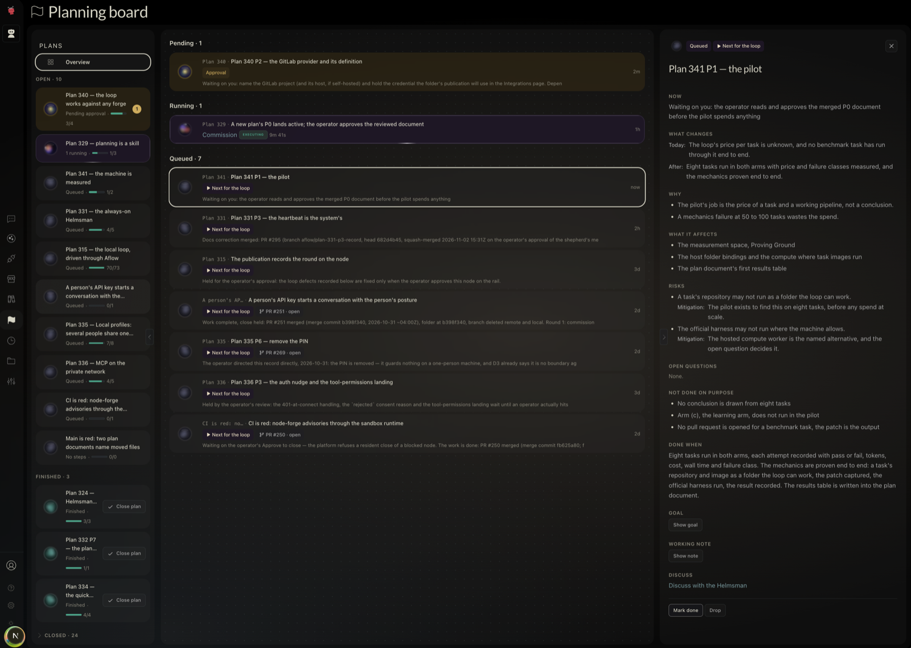
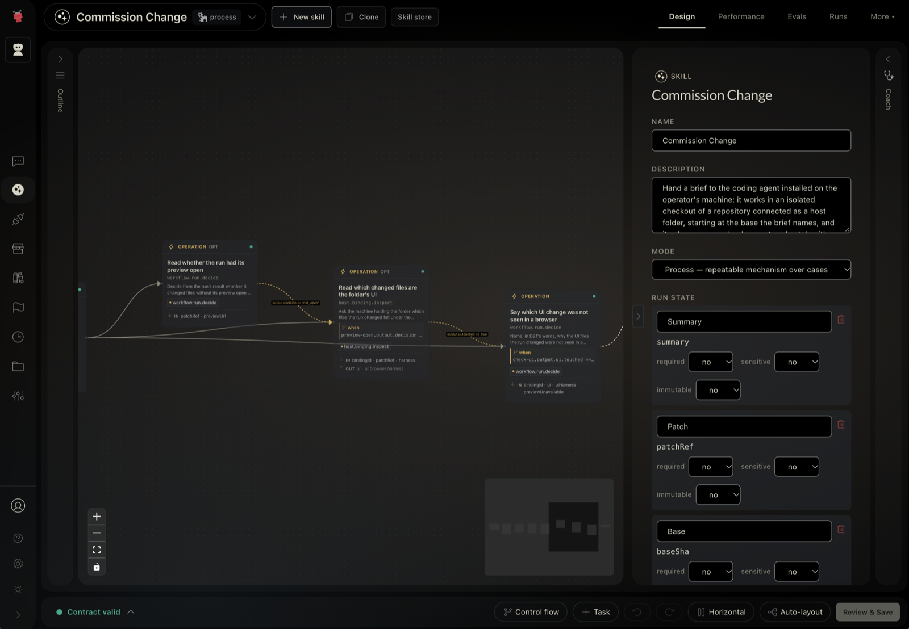
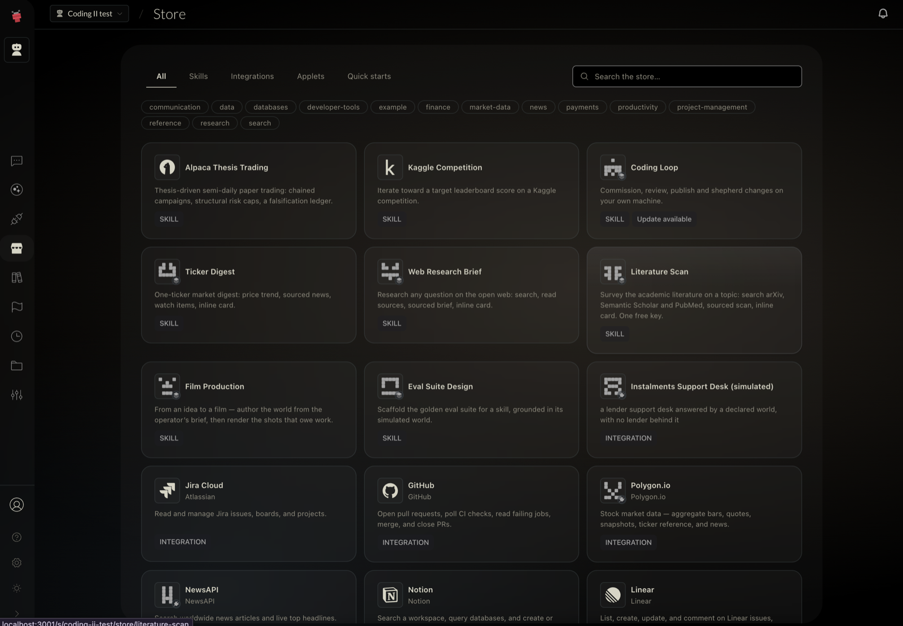

# Aflow

**An always-on agent on your own machine that works your plans around the clock —
and when a plan needs code, it drives your own coding agent, governed: confined,
approved, costed.**

**In about ten minutes you get a pull request on your own GitHub repository**,
opened by a coding-agent task that ran on a schedule. You write one change into
the space's plan. The agent's schedule wakes and hands the change to Claude Code
on your machine. It commits the result on a branch, scans it for secrets and asks
you before it pushes. You approve, and the pull request opens. The ten minutes is
your setup time, with the [prerequisites](#before-you-start) already on the
machine. The coding agent then takes as long as the change does.
[The walkthrough](#from-install-to-your-first-approved-pull-request) has every
command and screen in order.

Aflow keeps agents working while nobody is at the keyboard. An agent calls your
APIs, uses a browser on your machine, runs code in sandboxes, keeps memory, and
pauses for your approval. It hands work to the coding agent you already use —
Claude Code, Codex or OpenCode — as one step among the rest. Every model decision
and every tool call is a step you can inspect.

This repository is the **local edition**: one owner, on infrastructure you control.
No account, no licence server, and nothing phones home. Background work continues
for as long as Aflow and the computer are running.

> **Status:** active development. Interfaces and schemas change without deprecation
> shims.

---

## Before you start

There are two install paths, and they need different things. Start with the
first. Add the second when you want the agent to reach your own folders.

**The base install needs Docker.** Nothing else. It gives you chat, skills,
schedules and triggers, integrations, memory, sandboxed code and approvals.

|               |                                                                         |
| ------------- | ----------------------------------------------------------------------- |
| **Supported** | macOS with Docker Desktop. Linux is expected to work, not yet qualified |
| **Disk**      | ~4 GB for the published image; ~20 GB to build it from source           |
| **Model**     | An API key for OpenAI, Anthropic, Google or OpenRouter, or Ollama       |

**The coding-agent path needs a clone of this repository as well.** The program
that reaches your folders is the host executor. It runs as your own user, outside
the image, because reaching your real folders and toolchains is the point of it.
Today it runs from a clone, so this path also needs:

- **A clone of this repository.** The release bundle does not carry the host
  executor.
- **Node 22** and **Yarn 4.** `corepack enable` provides the Yarn version this
  repository pins.
- **A coding agent installed and signed in on the machine.** Claude Code, Codex
  or OpenCode.
- **A git repository** with at least one commit, whose `origin` is on GitHub.
- **A GitHub token** the agent can open pull requests with. Step 8 of the
  walkthrough lists its permissions.

The agent's own browser and its access to your folders come through the same
host executor, so they need the clone too. On Linux, confining a command also
needs `bubblewrap`, `ripgrep` and `socat`.

---

## Quick start

This is the base install. Download `aflow-appliance-<version>.tgz` from the
[latest release](https://github.com/aflowai/aflow/releases/latest), then:

```bash
mkdir aflow && tar -xzf aflow-appliance-*.tgz -C aflow && cd aflow
docker compose up -d
open http://127.0.0.1:3001
```

That pulls the published image, about 4 GB, and builds nothing. The bundle's own
README carries upgrade, rollback and backup.

To build the image from source instead:

```bash
git clone https://github.com/aflowai/aflow.git && cd aflow
docker compose -f docker-compose.local.yml up -d --build
```

There is no login — reaching the web app on loopback identifies you as the owner.
First run walks you through connecting a model provider; the key is stored
encrypted per workspace, not in a file.

|                    |                                                                                                |
| ------------------ | ---------------------------------------------------------------------------------------------- |
| **Lifecycle**      | From a clone: `yarn local:up` · `local:down` · `local:logs` · `local:backup` · `local:restore` |
| **Check it works** | `./scripts/appliance-smoke.sh` — needs only Docker                                             |

[`docs/dev/local-appliance.md`](docs/dev/local-appliance.md) is the operator guide:
secrets, backup and restore, upgrades, and sandboxed code execution.

---

## From install to your first approved pull request

Every command and every screen, in order. The example uses Claude Code on macOS.
Steps 1 to 3 are the base install. Steps 4 to 12 are the coding-agent path.

**1. Install and open it.** Run the [quick start](#quick-start) above, then open
http://127.0.0.1:3001.

**2. Finish first run.** **Name your workspace**, then **Choose your model**,
then paste that provider's API key. **Ready** offers a chat, the Store and
integrations. Choose **Go to your workspace**.

**3. Make a coding space.** Open the space selector at the top of the sidebar and
choose **Create new workspace**. Choose the **Coding with GitHub** quick start,
name the space and choose **Create workspace**. The space installs **Coding
Loop**: Commission Change, Review Local Changes, Publish Local Changes and the
Local PR Shepherd. It then lists what it still needs, on the Coding Loop listing
in the Store and on the space's help page:

- **Pair this machine**
- **Connect the repository's folder**
- **Bind a GitHub credential**
- **Choose the coding agent**
- **Arm the shepherd schedule**

Steps 4 to 9 bring each item to done.

**4. Clone this repository and install its dependencies.** The release bundle
does not carry the host executor, so it runs from a clone. Use Node 22.

```bash
git clone https://github.com/aflowai/aflow.git && cd aflow
corepack enable
yarn install
```

Run every command below from this clone. You do not need `yarn start`: the
appliance from step 1 is the running stack, and two stacks on one machine get in
each other's way.

**5. Allow the coding agent on this machine.** Each coding agent starts able to
reach nothing.

```bash
yarn workspace @aflow/aflow-executor-host harness list
yarn workspace @aflow/aflow-executor-host harness add claude
```

On macOS, a signed-in Claude Code usually keeps its token in the Keychain, which
a confined process cannot reach. `harness add` then needs `--credential` flags
that name a command to read it. They are in the operator guide, under
[Putting a coding agent to work](docs/dev/local-appliance.md#putting-a-coding-agent-to-work).

**6. Connect the repository's folder.** In the web app, choose **This Computer**
in the sidebar. Under **Connect a folder**, choose **Get a code**, then **Copy
command**. The page shows this command, with your code in it:

```bash
yarn workspace @aflow/aflow-executor-host connect <code>
```

Run it in the clone, with three flags added:

```bash
yarn workspace @aflow/aflow-executor-host connect <code> --write --run --push-approval always
```

The Finder folder chooser opens. Choose your repository. `--write` and `--run`
answer the two questions it would otherwise ask. A git repository whose commands
may run publishes to branches under `aflow/` and is never force-pushed.
`--push-approval always` makes every push wait for your approval. The default,
`unless-unreviewed`, pushes without asking when the loop's own review approves the
commit. The merge posture stays at its default, `never`, so merging is yours. The
code lasts a few minutes and works once.

The setup list writes this step as
`aflow connect <code> --write --run --branch-prefix <prefix> --merge-posture <never|when-green>`.
No command named `aflow` is installed. Run the command the This Computer page
shows, with the same flags.

**7. Start the machine's side.** The command in step 6 ends with
`Ready to use.` when the executor already runs. Otherwise it prints what to run:

```bash
yarn executor:host
```

Leave that terminal open. To have it start at login instead, stop it and run
`yarn workspace @aflow/aflow-executor-host service install`. Only one executor
may run at a time. **Pair this machine** and **Connect the repository's folder**
now read done.

**8. Bind a GitHub credential.** Open **Integrations** in the sidebar and bind a
token to the **github** connection. A fine-grained token needs Metadata and
Contents read, Checks and Actions read, and Pull requests and Issues write. A
classic token needs `repo`, or `public_repo` for a public repository.

**9. Choose the coding agent and arm the shepherd.** On **This Computer**, choose
Claude Code as the coding agent the space runs. Then arm the shepherd schedule
from its item in the setup list. The Local PR Shepherd tends a pull request once
it is open. Choose **Check setup again** until every item reads done.

**10. Put one change on the plan, and start the schedule.** Open **Chat** and ask
the Helmsman for a plan, then for its schedule:

> Add a plan for my repository with one step: fix the typo in the README's
> install section. Then create this space's resident schedule.

The resident schedule wakes every fifteen minutes. It reads the plan and starts
the next approved step. Open **Plan** in the sidebar to see the step on the
**Planning board**. A step that waits on your decision stands under **Pending**:
open it and choose **Approve**. Approving wakes the resident at once. Approved
work stands under **Queued**, marked **Next for the loop**, and needs nothing
from you.

**11. Watch it work.** The resident commissions Claude Code on your folder, in a
private clone at the repository's current commit. Your working tree is not
touched. The resident's run is a conversation under **Chat**, with the coding
agent's live output, its tool calls and the files it is changing. The step moves
to **Running** on the Planning board. Publish Local Changes then commits the
patch on a branch under `aflow/`, runs the folder's checks and scans the push for
secrets. Under `--push-approval always` no review runs, because you are the one
who clears the push.

**12. Approve the push.** The push waits in the **Workbench** beside the chat,
under **Pending**. The card names the commit and what the scan found. Choose
**Approve**. The branch is pushed and the pull request opens on GitHub. Its card
on the Planning board shows **PR #…**. Declining pushes nothing and leaves the
branch on your machine.

The pull request is yours to merge. Once you merge it, the resident records the
merge on the step and starts the next approved one. Every step of the run, with
its tokens and cost, is on the run's record.

---

## When a plan needs code



Connect a folder, and Aflow gives work in it to the coding agent installed on
your machine — signed in as you, with your toolchain around it.

- **Ask in chat.** An Aflow agent hands the task to the coding agent and reads
  back the result.
- **Or make it a step in a skill.** The coding agent becomes one node in a
  workflow, alongside your APIs, sandboxed code, memory and approvals — run on
  demand, on a schedule, or when something happens.
- **Or put it on the plan.** The resident takes approved steps on its schedule.
  It commissions the change, reviews it and publishes it.

What Aflow adds around the coding agent:

- **Confined.** Each run works in a private clone of its own, so your
  uncommitted work is untouched. Its commands run under a policy the operating
  system enforces. Your home folder is denied, and egress is closed until you
  allow a host. A machine that cannot enforce the policy refuses to run commands.
- **Approved.** Changes arrive on a branch under a prefix you set. A push asks
  you first, unless you set the folder to let the loop's own review clear it.
  Every push is scanned for secrets, and a secret stops it. A merge asks for your
  approval of that exact request.
- **Costed.** Every step records its tokens and its cost. A plan step stops once
  its runs reach its spend ceiling, $50 by default, and waits for you.
- **A result you can use.** The task declares the shape of what it needs. The
  answer is validated, and a run that ends without one fails and can be retried.

Setting up a coding agent is in the operator guide under
[Putting a coding agent to work](docs/dev/local-appliance.md#putting-a-coding-agent-to-work).

---

## Plans, worked around the clock



The Helmsman keeps each body of work as a plan of steps. Its resident schedule
wakes, reads every open plan in the order they stand on the board, and acts. It
starts the next approved step, publishes a finished commission and records a
merged pull request on its step. A step that needs a decision waits under
**Pending** until you **Approve**, **Revise** or **Drop** it. While every step
waits, a scheduled wake starts no model run and spends no tokens.

---

## What it does

- **Always on.** Cron schedules, webhooks, and runs that start when another
  finishes keep work going between conversations.
- **A browser of its own.** An agent opens pages in Chrome on the paired machine,
  signed in to the sites you choose, and each profile sets whether it acts or asks
  first.
- **Agents that delegate.** Agents choose their tools, hand work to sub-agents,
  and pick up where they left off — on OpenAI, Anthropic, Google or OpenRouter,
  with the cost of every step.
- **Skills that stay valid.** A skill is a procedure an agent has learned, with
  declared inputs and evals. It is checked again every time it runs, so a rule
  tightened today flags every skill it breaks.
- **Your tools, behind one surface.** Around two dozen connectors ship ready;
  anything else comes in by OpenAPI import. Credentials stay in per-workspace
  bindings, never inside a workflow.
- **Memory that is also a filesystem.** Documents with folders, search and
  backlinks — the same store an agent's code reads and writes.
- **Sandboxed code.** Python, Node, Deno or Bash in network-isolated containers.
- **You stay in the loop.** Steps ask for input or approval as cards in the app. A
  risky API write waits until you approve the exact request that will be sent.
- **Interfaces agents build.** Generated views and stateful applets, validated
  before they render.

Roughly 180 operations across 20+ step types. Browse them under **Catalog** in the
app, or run `yarn catalog:export`.





---

## How it compares

Plain terms, for someone choosing. Each of these does something better than
Aflow does.

- **n8n** is workflow automation with a visual editor and several hundred
  integrations. It does better on connector breadth, on teams, and on years of
  production use. In n8n you draw the workflow. In Aflow an agent decides the
  steps, keeps a plan, and hands code to your coding agent under your approval.
  Aflow ships around two dozen connectors and imports the rest from OpenAPI.
- **LangGraph** is a library for writing agent graphs in your own Python or
  JavaScript. It does better when the agent belongs inside your own product, and
  when you want control at the level of code. Aflow is an application you run,
  not a library you embed. The agent, the UI, approvals, schedules and storage
  are already there.
- **Temporal** is durable execution for workflows written as code. It does better
  on delivery guarantees at scale, on SDKs in many languages, and on clusters
  with a long production record. Aflow keeps durable state for one owner on one
  machine. It is not a general workflow engine.
- **Hosted coding agents**, such as the ones GitHub and OpenAI run in their
  clouds, do better on setup and on scale. Nothing on your side has to stay
  awake, and many tasks run side by side. Aflow runs your own signed-in coding
  agent on your machine, with your toolchain and your local services. It works
  the change as one step of a plan beside work that is not code, and every push
  waits on rules you set. Your computer has to be on, and one machine runs only
  so much at once.

## What it cannot do yet

- **Publish anywhere but GitHub.** The loop opens and tends pull requests
  through the GitHub connector only.
- **Run qualified anywhere but macOS.** Linux is expected to work and is not yet
  qualified. No other platform is qualified.
- **Be reached from another machine.** The web app answers on loopback only, and
  exposing it to a network is not supported. The optional Slack channel app can
  send you messages and some approval cards while you are away. It is not a way
  into the app.

The operator guide lists the rest under
[What the local edition does not have](docs/dev/local-appliance.md#what-the-local-edition-does-not-have).

---

## How it works

A Fastify API writes to Redis streams; an orchestrator is the single writer of
durable run state; stateless executors claim jobs per step type and write results
back. Redis holds live state, Postgres is the durable record, and large payloads go
to a payload store by reference rather than through agent context.

Zod schemas in `@aflow/schemas` are the single source of truth — types, JSON
Schema and OpenAPI are derived from them, so an operation cannot drift from its
contract. [`docs/architecture/`](docs/architecture/) has the diagrams.

## What crosses the network

**Leaves the machine** — only calls you configure: model providers, and the
integrations and MCP servers you connect. No telemetry, crash reporting,
analytics or update checks.

**Comes in** — when an interactive artifact uses them, your browser loads
open-source libraries (React, charting, maps and similar) from public
CDNs (jsDelivr, esm.sh); catalog provider logos load from an image host. Those
hosts see a request for a library or image, never your data. Such artifacts need
a network connection to render.

---

## Development

```bash
yarn install
yarn start
```

`yarn start` does the rest: creates `.env`, brings up Postgres and Redis, builds
once, applies migrations, provisions the instance, and starts the stack in watch
mode on the same ports as the appliance. It checks what it needs first and names
anything it cannot fix.

Afterwards `yarn start` is still the command — the build and the datastores are
skipped when they are already there.

**Which one to run.** The appliance above is what ships: the built image, no
toolchain, closest to what another person will run. The development stack is the
same edition from source with watch mode, so an edit is live immediately. They
keep **separate data** — the appliance has its own Postgres inside its Compose
project, the development stack uses `aflow-postgres` on 5433 — so work in one is
not visible in the other.

Before opening a pull request:
`yarn format && yarn typecheck && yarn test:changed && yarn lint`.

[`docs/dev/CONTRIBUTING.md`](docs/dev/CONTRIBUTING.md) covers standards and the
gotchas that catch most first contributions.

## Documentation

| Document                                                                                 | What it covers                                      |
| ---------------------------------------------------------------------------------------- | --------------------------------------------------- |
| [`docs/dev/local-appliance.md`](docs/dev/local-appliance.md)                             | Running, backing up and upgrading Aflow Local       |
| [`docs/dev/CONTRIBUTING.md`](docs/dev/CONTRIBUTING.md)                                   | Code standards, workflow, common mistakes           |
| [`docs/dev/integrations-and-capabilities.md`](docs/dev/integrations-and-capabilities.md) | Discovering, binding and calling integrations       |
| [`docs/dev/debugging-runs.md`](docs/dev/debugging-runs.md)                               | Tracing a run through Redis, streams and the DB     |
| [`docs/architecture/`](docs/architecture/)                                               | Flow execution, system diagrams, background work    |
| [`docs/plans/README.md`](docs/plans/README.md)                                           | How to propose a change large enough to need a plan |
| [`CLAUDE.md`](CLAUDE.md)                                                                 | Working context for AI coding agents                |

---

## Licence

**AGPL-3.0-or-later** — full text in [LICENSE](LICENSE), copyright and
attributions in [NOTICE](NOTICE). Running Aflow, privately or inside your
organisation, asks nothing of you. Modifying it and letting other people use it
over a network means offering those users your source.

A **commercial licence** is available for organisations that cannot accept those
terms — support@aflow.ai. The name and logo are trademarks the software licence
does not cover; [TRADEMARK.md](TRADEMARK.md) permits most ordinary uses.

[Contributing](CONTRIBUTING.md) · [Conduct](CODE_OF_CONDUCT.md) ·
[Security](SECURITY.md)
